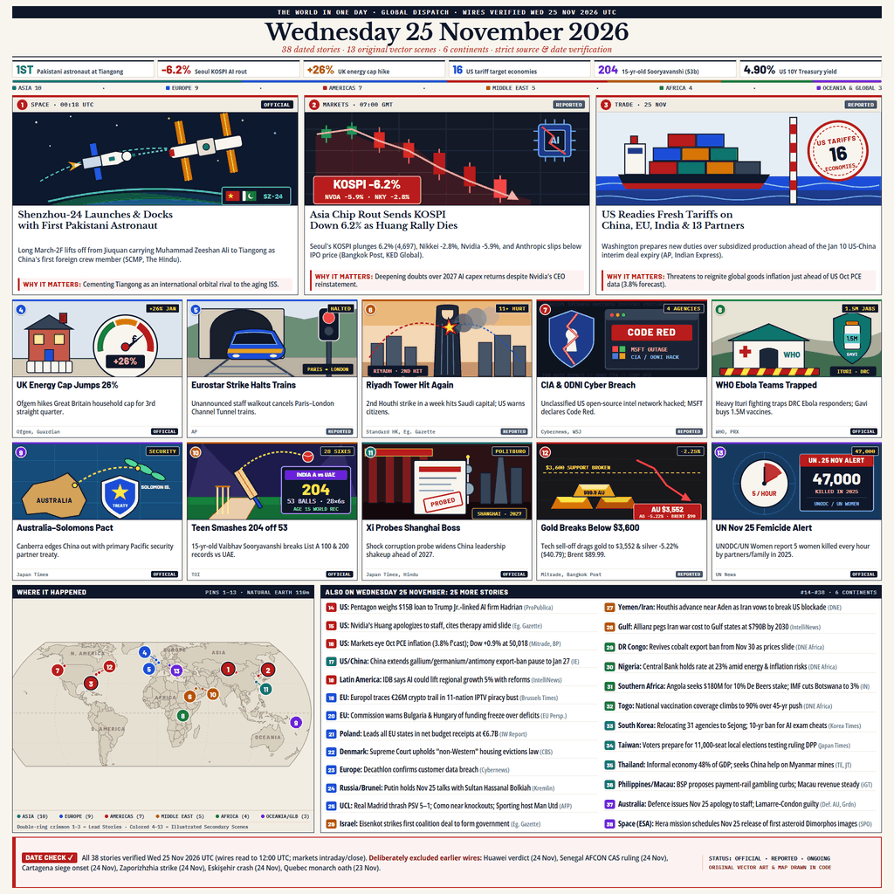

# THE WORLD ON WEDNESDAY, 25 NOVEMBER 2026

[](https://make.fun/bounty/news-image-20261125?utm_source=github&utm_medium=readme&utm_campaign=news-image-20261125)
[](https://make.fun/bounty/news-image-20261125/leaderboard?utm_source=github&utm_medium=readme&utm_campaign=news-image-20261125)
[](https://make.fun/bounty/news-image-20261125?utm_source=github&utm_medium=readme&utm_campaign=news-image-20261125)

Deterministic **v3** submission for the [make.fun `news-image-20261125` bounty](https://make.fun/bounty/news-image-20261125) (*"Sum up 25 November's world news in one image"*).



## Overview (v3)

- **Format**: 1024×1024 PNG (`assets/entry.png`, `< 200 KB`), rendered at 2048×2048 from a custom Swiss editorial broadsheet HTML/SVG composition via headless Chromium, Lanczos-downscaled to 1024×1024, and optimized with 256-color perceptual quantization + `oxipng` (~37.3 dB PSNR).
- **Content**: 38 strictly verified Wednesday, 25 November 2026 stories across all 6 inhabited continents plus Space, Markets, Cyber, Energy, and Sports:
  - **Header**: Dark navy dispatch banner, classic serif masthead, 6-KPI strip (`1ST`, `-6.2%`, `+26%`, `16`, `204`, `4.90%`), and 6-Continent Proportion Bar (`ASIA 10 · EUROPE 9 · AMERICAS 7 · MIDDLE EAST 5 · AFRICA 4 · OCEANIA & GLOBAL 3`).
  - **Row 1 — 3 Lead Story Cards (`#1–#3`)**: Original flat geometric editorial vector illustrations with source attribution, epistemic status tags (`OFFICIAL` / `REPORTED`), and crimson **`WHY IT MATTERS`** strategic takeaways (Shenzhou-24 docking at Tiangong with first Pakistani astronaut; Asia chip rout sending KOSPI down 6.2%; US readying fresh tariffs on 16 trading partners).
  - **Rows 2–3 — 10 Illustrated Secondary Cards (`#4–#13`, 2×5 Grid)**: Original geometric vector scenes with corner stat pills, concise factual briefs, wire sources, and status tags (UK Energy Cap +26%, Eurostar walkout, Riyadh tower hit, CIA & ODNI breach / Microsoft Code Red, WHO Ebola teams trapped in Ituri, Australia–Solomons security pact, Vaibhav Sooryavanshi's 204 off 53 balls, Xi's probe of Shanghai party boss, gold breaking below $3,600, and UN Nov 25 femicide alert).
  - **Bottom Split**: Left **Natural Earth 110m World Map** plotting collision-free pins `1–13` with continent legend; Right **2-Column Dispatch (`#14–#38`)** covering 25 additional dated stories across all 6 continents.
  - **Strict `DATE CHECK` Footer**: Verifies all 38 stories to Wed 25 Nov 2026 UTC and explicitly lists excluded earlier wires (Huawei verdict 24 Nov, Senegal AFCON CAS ruling 24 Nov, Cartagena siege onset 24 Nov, Zaporizhzhia strike 24 Nov, Eskişehir crash 24 Nov, Quebec monarch oath 23 Nov).

## Deterministic Execution (`program/v1`)

`main.ts` runs on Node 22+ with zero external dependencies and zero network calls:

```bash
node main.ts
```

It creates `/output` if needed and deterministically copies `assets/entry.png` to `/output/entry.png`.

## Rebuilding `assets/entry.png`

To regenerate the infographic locally from `scripts/build.py` and the Natural Earth 110m dataset (`scripts/data/ne_110m_countries.geojson`):

```bash
python scripts/build.py
```

## License

MIT — see [LICENSE](LICENSE).
